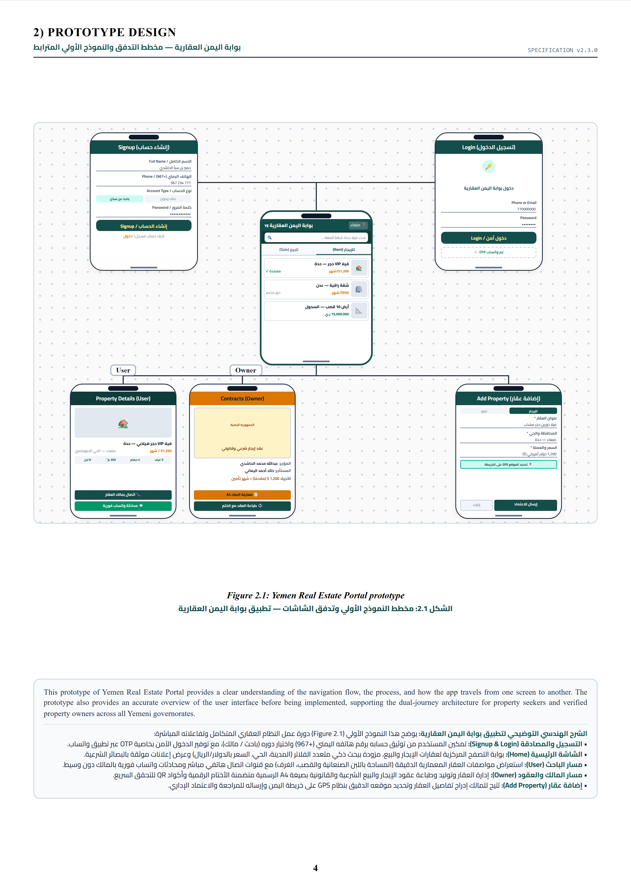
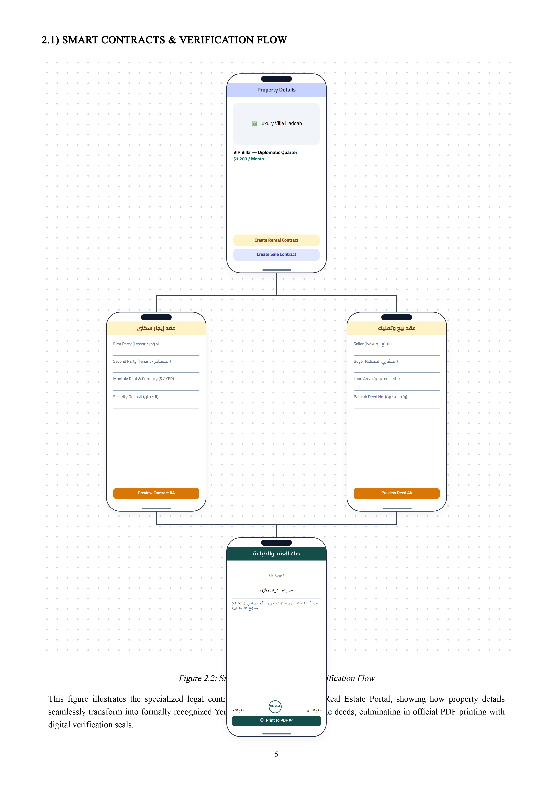
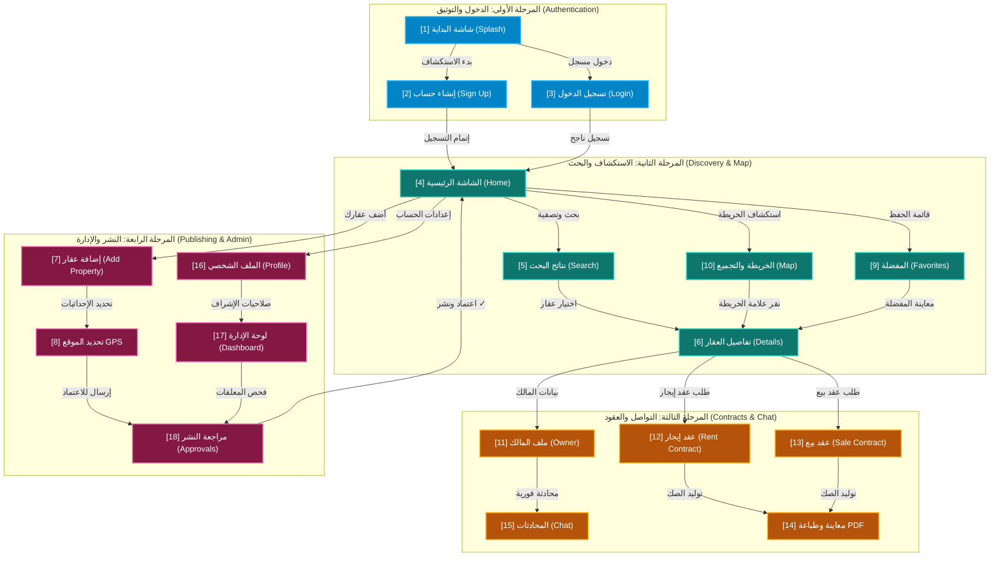

# 🇾🇪 تقرير التصميم التفصيلي للنموذج الأولي ومخطط الشاشات
## PROTOTYPE DESIGN & SYSTEM SCREENS SPECIFICATION REPORT
### مشروع: بوابة اليمن العقارية | Yemen Real Estate Portal

---

```text
المشروع       : بوابة اليمن العقارية (Yemen Real Estate Portal)
نوع الوثيقة   : وثيقة التصميم التفصيلي للنموذج الأولي وتدفق تجربة المستخدم (UI/UX Prototype Design Report)
الإصدار        : 2.3.0 FINAL
تاريخ التوثيق  : نوفمبر 2026
المرجع         : معايير التوثيق الهندسي للبرمجيات وتصميم واجهات المستخدم (IEEE 830 / UI-UX Flow Specifications)
```

---

## 📑 فهرس المحتويات (Table of Contents)
1. **مقدمة النموذج الأولي والمخطط العام (Prototype Overview & Architecture)**
2. **المخطط البصري لتدفق الشاشات (Figure 2.1: Complete Prototype & Navigation Flow)**
3. **التوصيف الدقيق والتفصيلي لكافة الشاشات الـ 18 (Detailed Specifications for All 18 Screens)**
   - *المرحلة الأولى: الدخول والتوثيق (Onboarding & Authentication)*
     - 1. شاشة البداية (Splash Screen)
     - 2. شاشة إنشاء حساب جديد (Sign Up Screen)
     - 3. شاشة تسجيل الدخول (Login Screen)
   - *المرحلة الثانية: الاستكشاف، البحث، والخريطة (Discovery, Search & Map)*
     - 4. الشاشة الرئيسية (Home Screen)
     - 5. شاشة نتائج البحث والتصفية المتقدمة (Search & Filter Results Screen)
     - 6. شاشة تفاصيل العقار (Property Details Screen)
     - 7. شاشة المفضلة (Favorites Screen)
     - 8. شاشة خريطة اليمن العقارية ومحرك التجميع (Yemen Real Estate Map Screen)
   - *المرحلة الثالثة: التواصل ومنظومة العقود الذكية (Contracts & Communications)*
     - 9. شاشة ملف صاحب العقار والمكتب المعتمد (Owner & Office Profile Screen)
     - 10. شاشة المحادثات والتفاوض المباشر (Chat & Inquiries Screen)
     - 11. شاشة إنشاء عقد إيجار شرعي وقانوني (Rental Contract Screen)
     - 12. شاشة إنشاء عقد بيع وتمليك (Sale & Deed Contract Screen)
     - 13. شاشة معاينة العقد والطباعة الرسمية A4 PDF (Contract Preview Screen)
   - *المرحلة الرابعة: إضافة العقارات، المراجعة، والإدارة (Publishing & Administration)*
     - 14. شاشة إضافة عقار جديد (Add Property Screen)
     - 15. شاشة تحديد الموقع الدقيق على الخريطة (Pick Location on Map Screen)
     - 16. شاشة الملف الشخصي والإعدادات (Profile & Settings Screen)
     - 17. لوحة تحكم المدير العام (Admin Dashboard Screen)
     - 18. شاشة مراجعة طلبات النشر واعتمادها (Property Approvals Review Screen)
4. **مصفوفة تتبع مسارات التنقل (Navigation Traceability Matrix)**
5. **المعايير المحددة للبيئة العقارية اليمنية (Yemeni Real Estate Domain Rules)**

---

## 1. مقدمة النموذج الأولي والمخطط العام (Prototype Overview)

يوفر هذا النموذج الأولي (**Interactive Prototype**) محاكاة بصرية وهندسية متكاملة لتطبيق **بوابة اليمن العقارية**. يهدف النموذج إلى تقديم رؤية واضحة ودقيقة لكيفية انتقال المستخدم بين مختلف الشاشات، وفهم سلوك وتفاعل كل عنصر قبل تنفيذه برمجياً.

تم تصميم الشاشات وفق دراسة معمقة لاحتياجات السوق العقاري اليمني:
- دعم كامل للغة العربية (RTL) مع خطوط مريحة للعين (**Cairo** للواجهات، و**Amiri** للمحررات والعقود الرسمية).
- هوية بصرية تراثية فاخرة تعتمد اللون الأخضر التراثي اليمني الهادئ (**Deep Teal - #134E4A**) مدمجاً بلمسات ذهبية عنبرية (**Amber Gold - #D97706**).
- معالجة الوحدات العقارية اليمنية التراثية (اللبنة الصنعانية، القصبة، المتر المربع) والعملات المتداولة (ريال يمني YER، دولار أمريكي USD، ريال سعودي SAR).
- منظومة عقود إلكترونية مطابقة لأحكام القانون المدني اليمني وأعراف توثيق البصائر الشرعية.

---

## 2. المخطط البصري لتدفق الشاشات (Figure 2.1: Navigation Flow Architecture)

يُظهر الشكلان أدناه الترابط الهيكلي والمسارات الوظيفية المترابطة بين شاشات تطبيق بوابة اليمن العقارية:

### 🖼️ الشكل 2.1: المخطط الهيكلي الأساسي للنموذج الأولي


> **Figure 2.1 Analysis**: يوضح هذا النموذج الأولي لمشروع **بوابة اليمن العقارية (Yemen Real Estate Portal)** دورة تدفق تجربة المستخدم وانتقال البيانات بين الشاشات: بدءاً من تسجيل الحساب والدخول برقم الهاتف اليمني (+967)، مروراً بالشاشة الرئيسية وتصفح عقارات الإيجار والبيع في المحافظات اليمنية، وتفريع مسار تجربة الباحث (User) لمعاينة المواصفات باللبن الصنعانية والتواصل المباشر مع المالك، ومسار المالك (Owner) لصياغة وتوليد عقود الإيجار والبيع الشرعية المعتمدة وطباعتها بصيغة A4 مع الختم الرقمي وكود QR، وصولاً إلى معالج إضافة العقار وتحديد الموقع الدقيق عبر الـ GPS ورفعه للاعتماد الإداري.

---

### 📑 الشكل 2.2: مسار منظومة العقود الذكية والتوثيق القانوني


> **Figure 2.2 Analysis**: يوضح انتقال بيانات العقار مباشرة إلى محرر عقود الإيجار والبيع المصاغة وفق أحكام القانون المدني اليمني، مع إتاحة المعاينة والطباعة الرسمية A4 PDF مع الختم الرقمي وكود التحقق QR.

---

### 🧭 المخطط الانسيابي التفصيلي لكافة الشاشات:



---

## 3. التوصيف الدقيق والتفصيلي لكافة الشاشات الـ 18

### ─── المرحلة الأولى: الدخول والتوثيق (Onboarding & Authentication) ───

```
+-------------------------------------------------------+
|  [1] شاشة البداية والترحيب (Splash Screen)             |
+-------------------------------------------------------+
```
* **الهدف الوظيفي (Functional Objective)**:  
  تقديم الهوية البصرية الرسمية لمنصة بوابة اليمن العقارية، تهيئة ملفات التكوين والتحقق من حالة الاتصال والوضع المحلي (Offline Demo Mode).
* **المكونات البصرية والتخطيط (UI Layout)**:
  - تدرج لوني عميق من اللون الأخضر التراثي (`#134E4A` إلى `#0A2624`).
  - أيقونة الهوية اليمنية التراثية داخل إطار زجاجي متوهج ومطعم بالذهب.
  - العنوان الرئيسي بخط كوفي/قاهري عريض: "بوابة اليمن العقارية".
  - الشعار اللفظي: "المنصة الذكية الأولى لتوثيق وإدارة العقارات في اليمن".
  - زر الحث على اتخاذ الإجراء (CTA): "ابدأ الاستكشاف الآن".
  - شارة الإصدار المعتمد: `v2.3.0 FINAL`.
* **المدخلات والشروط (Inputs & Rules)**:
  - لا توجد مدخلات من المستخدم في هذه الشاشة.
  - فحص تلقائي لوجود جلسة دخول سابقة (Session Token).
* **مسارات التنقل (Navigation Triggers)**:
  - النقر على "ابدأ الاستكشاف" ➔ الانتقال إلى الشاشة الرئيسية [4] أو شاشة إنشاء الحساب [2].
  - النقر على "تسجيل الدخول" ➔ الانتقال إلى شاشة الدخول [3].

---

```
+-------------------------------------------------------+
|  [2] شاشة تسجيل حساب جديد (Sign Up Screen)            |
+-------------------------------------------------------+
```
* **الهدف الوظيفي (Functional Objective)**:  
  تسجيل هوية مستخدم جديد مع تحديد صفته (باحث عن سكن / مالك عقار / مكتب ووسيط عقاري معتمد) وربطه برقم هاتف يمني.
* **المكونات البصرية والتخطيط (UI Layout)**:
  - محدد نوع الحساب (Segmented Selector): كرتان تفاعليان للاختيار بين "باحث عن عقار" و"مالك / مكتب عقاري".
  - حقل الاسم الكامل الثلاثي أو الرباعي.
  - حقل رقم الهاتف مسبوقاً بمفتاح الجمهورية اليمنية الدولي (`+967`) مع إتاحة التحقق عبر OTP.
  - حقل البريد الإلكتروني (اختياري للباحث وإلزامي للمكاتب والوسطاء).
  - حقل كلمة المرور مع مؤشر قوة التعقيد وأيقونة إظهار/إخفاء الرمز.
  - زر الإجراء الرئيسي: "إنشاء الحساب فوراً".
  - رابط بديل: "لديك حساب بالفعل؟ تسجيل الدخول".
* **قواعد التحقق (Validation Constraints)**:
  - رقم الهاتف يجب أن يتكون من 9 أرقام تبدأ بـ (77 أو 73 أو 71 أو 70).
  - كلمة المرور لا تقل عن 8 خانات وتحتوي على أحرف وأرقام.
* **مسارات التنقل (Navigation Triggers)**:
  - نجاح التسجيل ➔ تحويل المستخدم مباشرة إلى الشاشة الرئيسية [4] مع تفعيل الجلسة.
  - النقر على "تسجيل الدخول" ➔ الانتقال إلى شاشة تسجيل الدخول [3].

---

```
+-------------------------------------------------------+
|  [3] شاشة تسجيل الدخول (Login Screen)                 |
+-------------------------------------------------------+
```
* **الهدف الوظيفي (Functional Objective)**:  
  المصادقة الأمنية على المستخدمين المسجلين، مع دعم الدخول السريع المباشر وتفادي إغلاق الجلسات.
* **المكونات البصرية والتخطيط (UI Layout)**:
  - أيقونة المفتاح الذهبي التراثي.
  - حقل اسم المستخدم (رقم الهاتف أو البريد الإلكتروني).
  - حقل كلمة المرور مع خيار "تذكرني على هذا الجهاز".
  - زر "نسيت كلمة المرور؟".
  - زر الدخول الرئيسي: "دخول آمن".
  - قسم الدخول السريع: زر "رمز التحقق OTP عبر واتساب".
* **مسارات التنقل (Navigation Triggers)**:
  - صحة الاعتماد ➔ الانتقال إلى الشاشة الرئيسية [4].
  - الضغط على "إنشاء حساب" ➔ الانتقال إلى شاشة التسجيل [2].

---

### ─── المرحلة الثانية: الاستكشاف والبحث (Discovery & Map) ───

```
+-------------------------------------------------------+
|  [4] الشاشة الرئيسية (Home Screen)                    |
+-------------------------------------------------------+
```
* **الهدف الوظيفي (Functional Objective)**:  
  الواجهة المحورية لمنصة اليمن العقارية؛ تقدم البحث الفوري، تصفح المحافظات الـ 22، فلاتر الصفقات، وأحدث العقارات المعمدة بالبصائر الشرعية.
* **المكونات البصرية والتخطيط (UI Layout)**:
  - **الهيدر التراثي**: شعار اليمن مع محدد الموقع الحالي (صنعاء، عدن، كافة المحافظات)، وأيقونة التنبيهات مع شارة حمراء.
  - **شريط البحث اللحظي**: حقل بحث موسع يدعم البحث بالمدينة أو الحي (حدة، المنصورة، المكلا، الأصبحي).
  - **مبوبة الصفقات الثلاثية**: أزرار فلاتر سريعة بنمط كبسولات (الكل / للإيجار / للبيع والتمليك).
  - **شرائح المحافظات السريعة (Horizontal Carousel)**: شرائح قابلة للتمرير الأفقي (أمانة العاصمة، عدن، تعز، حضرموت، إب، الحديدة، مأرب، ذمار...).
  - **كرت العقار الترويجي البارز**: صورة عالية الجودة، شارة "موثق رسمي"، السعر بالعملة المحددة (مثال: $1,200 أو ر.ي)، عدد الغرف والحمامات والمساحة باللبن الصنعانية.
  - **شريط التنقل السفلي الموحد (Bottom Navigation Bar)**: 5 وجهات أساسية (الرئيسية، الخريطة، زر الإضافة الدائري البارز "+"، العقود، الملف الشخصي).
* **مسارات التنقل (Navigation Triggers)**:
  - النقر على شريط البحث ➔ الانتقال إلى شاشة البحث المتقدم [5].
  - النقر على أي كرت عقار ➔ فتح شاشة تفاصيل العقار [6].
  - النقر على تبويب الخريطة ➔ الانتقال لشاشة الخريطة التفاعلية [10].
  - النقر على زر الإضافة الدائري ➔ الانتقال لشاشة إضافة عقار [7].
  - النقر على تبويب العقود ➔ الانتقال لمنظومة العقود الذكية [12].

---

```
+-------------------------------------------------------+
|  [5] شاشة نتائج البحث والتصفية (Search Results Screen)|
+-------------------------------------------------------+
```
* **الهدف الوظيفي (Functional Objective)**:  
  تصفية دقيقة للعقارات وفق شروط ومعايير متعددة تشمل نوع العقار، النطاق السعري، والمديريات.
* **المكونات البصرية والتخطيط (UI Layout)**:
  - حقل إدخال استعلام البحث مع زر تفريغ سريع (✕).
  - زر الإعدادات المتقدمة (فلاتر إضافية: عدد الغرف، وجود طاقة شمسية، حوش سيارات).
  - شريط إحصائية المطابقة: "تم العثور على 18 عقاراً مطابقاً".
  - قائمة فرز ذكية: (الأحدث أولاً / الأقل سعراً / الأعلى سعراً).
  - كروت نتائج مدمجة وأنيقة مع الصور المصغرة والأسعار والمواقع.
* **مسارات التنقل (Navigation Triggers)**:
  - النقر على أي نتيجة ➔ فتح شاشة تفاصيل العقار [6].
  - النقر على زر الرجوع ➔ العودة للشاشة الرئيسية [4].

---

```
+-------------------------------------------------------+
|  [6] شاشة تفاصيل العقار (Property Details Screen)      |
+-------------------------------------------------------+
```
* **الهدف الوظيفي (Functional Objective)**:  
  استعراض الملف الفني والقانوني الكامل للعقار، مواصفاته الإنشائية، موقعه الجغرافي، والتواصل المباشر أو الانتقال لتوليد العقد.
* **المكونات البصرية والتخطيط (UI Layout)**:
  - **معرض الصور التفاعلي**: صور ملتقطة بدقة عالية للواجهات الحجرية والغرف والمرافق مع عداد الصور.
  - **شارات الثقة والتوثيق**: شارة "بصيرة معمدة وموثقة"، وشارة نوع الصفقة ("للإيجار" أو "للبيع").
  - **العنوان والسعر البارز**: اسم العقار التفصيلي، الموقع بالحي والشارع، والسعر بالدولار الأمريكي أو الريال اليمني.
  - **شبكة المواصفات الهندسية (Specs Grid)**: 4 مؤشرات رقمية واضحة (غرف النوم، دورات المياه، المساحة بالمتر المربع، المساحة باللبن الصنعانية).
  - **الوصف الإنشائي والمميزات**: نص وصفي مع وسوم للمزايا (طاقة شمسية 24 ساعة، خزان أرضي مستقل سعة 4 وايتات، واجهة حجر هيلاني طبيعي، حراسة، موقف سيارات).
  - **أزرار الإجراءات السفلية**:
    - زر ذهبي رئيسي بارز: "📑 توليد ومعاينة العقد الإلكتروني لهذا العقار".
    - زر اتصال هاتفي برقم يمني: "📞 اتصال بالمالك".
    - زر محادثة فورية مباشر: "💬 واتساب مباشر".
* **مسارات التنقل (Navigation Triggers)**:
  - النقر على "توليد العقد" ➔ الانتقال لشاشة إنشاء عقد الإيجار [12] أو عقد البيع [13] مع ملء بيانات العقار تلقائياً.
  - النقر على اسم المالك ➔ الانتقال لشاشة ملف المالك [11].
  - النقر على واتساب/محادثة ➔ فتح شاشة المحادثة المباشرة [15].

---

```
+-------------------------------------------------------+
|  [7] شاشة المفضلة (Favorites Screen)                  |
+-------------------------------------------------------+
```
* **الهدف الوظيفي (Functional Objective)**:  
  تمكين المستخدم من تتبع ومقارنة العقارات المحفوظة التي نالت إعجابه للرجوع إليها دون عناء البحث.
* **المكونات البصرية والتخطيط (UI Layout)**:
  - ترويسة مع عداد العقارات المحفوظة (مثال: "العقارات المفضلة (3)").
  - قائمة العقارات المفضلة مع الصور المصغرة والأسعار والمواقع.
  - زر حذف سريع من المفضلة (أيقونة القلب الممتلئ ❤️ باللون الوردي).
  - ميزة التخزين الدائم حتى عند انقطاع الاتصال (Local Persistence).
* **مسارات التنقل (Navigation Triggers)**:
  - النقر على أي كرت في المفضلة ➔ الانتقال لشاشة تفاصيل العقار [6].

---

```
+-------------------------------------------------------+
|  [8] شاشة خريطة اليمن العقارية (Yemen Real Estate Map)|
+-------------------------------------------------------+
```
* **الهدف الوظيفي (Functional Objective)**:  
  استكشاف عقارات اليمن عبر الخريطة التفاعلية الذكية مع دعم التجميع المكاني (Spatial Clustering) وحدود المحافظات دون الحاجة لاتصال مستمر بالإنترنت.
* **المكونات البصرية والتخطيط (UI Layout)**:
  - **خريطة متجهة (Vector Canvas)**: تمثيل جغرافي دقيق للمحافظات والمدن اليمنية (صنعاء، عدن، تعز، المكلا، إب، الحديدة، مأرب...).
  - **دوائر التجميع العنقودي (Cluster Bubbles)**: دوائر خضراء متوهجة تنبض بالحركة وتوضح عدد العقارات المتوفرة في كل محافظة (صنعاء: 14، عدن: 8، المكلا: 9...).
  - **فلاتر الخريطة العائمة**: قائمة اختيار سريعة للتركيز على محافظة معينة، وأزرار تصفية سريعة لـ (إيجار / بيع).
  - **أزرار التحكم بالخريطة**: أزرار التكبير والتصغير (+ / -)، زر تبديل نمط القمر الصناعي (Satellite View)، وزر إعادة التوسيط لليمن.
  - **الكرت السفلي المنبثق (Sliding Bottom Sheet)**: عند النقر على أي علامة أو مدينة ينبثق كرت سفلي يعرض صورة وسعر العقار المتاح مع زر لمعاينة تفاصيله أو الانتقال لصياغة عقده فوراً.
* **مسارات التنقل (Navigation Triggers)**:
  - النقر على "معاينة العقار" في الكرت السفلي ➔ الانتقال لشاشة تفاصيل العقار [6].

---

### ─── المرحلة الثالثة: التواصل ومنظومة العقود الذكية (Contracts & Communications) ───

```
+-------------------------------------------------------+
|  [9] شاشة ملف صاحب العقار والمكتب (Owner Profile)     |
+-------------------------------------------------------+
```
* **الهدف الوظيفي (Functional Objective)**:  
  عرض السجل المهني والتراخيص الرسمية لصاحب العقار أو المكتب العقاري، لتعزيز الموثوقية والأمان ومنع الاحتيال.
* **المكونات البصرية والتخطيط (UI Layout)**:
  - بطاقة هوية المكتب أو المالك: الاسم، الشعار، وشارة "مكتب عقاري معتمد".
  - رقم الترخيص التجاري أو العقاري الرسمي (مثال: ترخيص رقم 4108).
  - شريط التقييمات العامة (نظام النجوم مع متوسط التقييم: ★★★★★ 4.9/5).
  - إحصائيات النشاط: عدد العقارات المعروضة، وعدد العقود المنجزة والموثقة.
  - أزرار التواصل المباشر (اتصال، واتساب، ومحادثة داخلية).
  - قائمة العقارات الأخرى المتاحة التابعة لنفس المالك.
* **مسارات التنقل (Navigation Triggers)**:
  - النقر على زر المحادثة ➔ الانتقال لشاشة المحادثة المباشرة [15].
  - النقر على أي عقار من عقارات المالك ➔ فتح تفاصيل العقار [6].

---

```
+-------------------------------------------------------+
|  [10] شاشة المحادثات والتفاوض المباشر (Chat Screen)   |
+-------------------------------------------------------+
```
* **الهدف الوظيفي (Functional Objective)**:  
  توفير قناة تواصل وتفاوض آمنة ولحظية بين الباحث ومالك العقار مع إمكانية اقتباس كرت العقار المعني.
* **المكونات البصرية والتخطيط (UI Layout)**:
  - شريط علوي يحمل اسم المالك وحالته ("متصل الآن 🟢").
  - كرت الاقتباس العلوي المدمج: يوضح صورة العقار محل التفاوض وسعره لضمان وضوح موضوع المحادثة.
  - فقاعات المحادثة الثنائية بتصميم مريح ومتناسق.
  - شريط إدخال الرسائل مع زر الإرسال وزر إرفاق الصور أو البصائر.
* **مسارات التنقل (Navigation Triggers)**:
  - النقر على كرت العقار المقتبس ➔ العودة لتفاصيل العقار [6].

---

```
+-------------------------------------------------------+
|  [11] شاشة إنشاء عقد إيجار شرعي (Rental Contract Form)|
+-------------------------------------------------------+
```
* **الهدف الوظيفي (Functional Objective)**:  
  صياغة عقد إيجار رسمي إلكتروني يستوفي كافة الشروط الشرعية وأحكام القانون المدني اليمني، مع تحديد الأجرة والضمان ومسؤوليات الصيانة.
* **المكونات البصرية والتخطيط (UI Layout)**:
  - ترويسة واضحة: "إنشاء عقد إيجار شرعي وقانوني موثق".
  - **حقول الطرف الأول (المؤجر)**: الاسم الرباعي، رقم الهوية/البطاقة الشخصية، ورقم الهاتف.
  - **حقول الطرف الثاني (المستأجر)**: الاسم الرباعي، رقم الهوية/جواز السفر، ورقم الهاتف.
  - **بيانات العين المؤجرة**: نوع العين (شقة، فيلا، دكان)، المحافظة، المديرية، واسم الحي والشارع.
  - **الأمور المالية**: القيمة الإيجارية الشهرية، نوع العملة (دولار / ريال يمني / ريال سعودي)، ومبلغ التأمين/الضمان.
  - **المدة والشروط**: مدة العقد (سنة هجرية / ميلادية)، تاريخ سريان العقد، وشروط فواتير الخدمات والصيانة.
  - زر الإجراء الرئيسي: "معاينة صك العقد والطباعة A4 PDF 📄".
* **قواعد التحقق (Validation Constraints)**:
  - إلزامية إدخال أسماء وبيانات الهوية لكلا الطرفين.
  - التأكد من تطابق العملة مع بيانات العقار الأصلية.
* **مسارات التنقل (Navigation Triggers)**:
  - النقر على "معاينة الصك" ➔ الانتقال لشاشة معاينة العقد والطباعة [13].

---

```
+-------------------------------------------------------+
|  [12] شاشة إنشاء عقد بيع وتمليك (Sale & Deed Contract)|
+-------------------------------------------------------+
```
* **الهدف الوظيفي (Functional Objective)**:  
  صياغة عقد بيع وشراء وتمليك عقار يوثق إسقاط ملكية البائع ونقلها للمشتري وفق الأصول الشرعية وسجلات التوثيق والمحاكم اليمنية.
* **المكونات البصرية والتخطيط (UI Layout)**:
  - ترويسة رسمية: "عقد بيع وشراء وتمليك عقار معمد".
  - **بيانات البائع (المسقط لملكه)** والمشتري (المتملك للعين).
  - **المساحة بالوحدات التراثية**: المساحة باللبن الصنعانية العشارية، أو القصب، أو المتر المربع.
  - **وثائق الملكية وأرقام البصائر**: حقل لرقم البصيرة الشرعية الأصلية، تاريخها، واسم محررها ومعمدها الشرعي.
  - **الثمن الإجمالي المتفق عليه** وآلية السداد (نقداً / شيك مقبول الدفع / دفعات).
  - زر الإجراء: "معاينة صك البيع والختم الرقمي 📄".
* **مسارات التنقل (Navigation Triggers)**:
  - إتمام البيانات والنقر على معاينة ➔ الانتقال لشاشة معاينة العقد والطباعة [13].

---

```
+-------------------------------------------------------+
|  [13] شاشة معاينة العقد والطباعة (Contract Preview)   |
+-------------------------------------------------------+
```
* **الهدف الوظيفي (Functional Objective)**:  
  تقديم معاينة حية ومطابقة لصك العقد كما سيظهر تماماً على ورقة الطباعة القياسية (A4)، مع الختم الرقمي ورمز الاستجابة السريعة (QR Code) للتحقق، ودعم الطباعة المباشرة والتصدير لـ PDF.
* **المكونات البصرية والتخطيط (UI Layout)**:
  - **ورقة الصك الرسمية (A4 Sheet Simulation)** بخلفية بيضاء وخط أميري عربي أصيل (`font-amiri`):
    - ترويسة: "الجمهورية اليمنية" مع البسملة والعنوان القانوني للعقد.
    - الديباجة الشرعية: "بعون الله وتوفيقه تم الاتفاق والتراضي بين كل من...".
    - البنود التفصيلية: البند الأول (العين)، البند الثاني (المدة)، البند الثالث (القيمة الإيجارية أو ثمن البيع)، البند الرابع (الالتزامات)، البند الخامس (الفسخ والضمان).
    - مساحات التوقيعات: توقيع وبصمة الطرف الأول، وتوقيع وبصمة الطرف الثاني.
    - **الختم الرسمي الإلكتروني (Official Verification Seal)**: ختم دائري معتمد يحمل رمز الـ QR ورقم القيد المرجعي الموثق.
  - **شريط أزرار التحكم**:
    - زر أخضر داكن: "🖨️ طباعة A4 بصيغة PDF" (يطلق نافذة الطباعة الافتراضية بنظام تنسيق احترافي).
    - زر مشاركة مباشر: "📤 إرسال صك العقد للواتساب".
* **مسارات التنقل (Navigation Triggers)**:
  - النقر على "طباعة" ➔ تفعيل أمر `window.print()` لطباعة وتصدير ملف PDF.
  - النقر على زر الرجوع ➔ العودة لمحرر العقد للتعديل إن لزم الأمر.

---

### ─── المرحلة الرابعة: إضافة العقارات، المراجعة، والإدارة (Publishing & Administration) ───

```
+-------------------------------------------------------+
|  [14] شاشة إضافة عقار جديد (Add Property Wizard)      |
+-------------------------------------------------------+
```
* **الهدف الوظيفي (Functional Objective)**:  
  معالج خطوة بخطوة يمكّن الملاك والوسطاء من إدخال وتوثيق عقاراتهم الجديدة ورفع وثائق الملكية لإرسالها لمراجعة الإدارة قبل النشر.
* **المكونات البصرية والتخطيط (UI Layout)**:
  - عنوان العقار الإعلاني البارز.
  - نوع الصفقة (للإيجار / للبيع والتمليك).
  - نوع العقار (شقة سكنية، فيلا مستقلة، أرضية، عمارة استثمارية، محل تجاري).
  - اختيار المحافظة والمديرية والحي.
  - السعر المطلوب واختيار العملة (USD / YER / SAR).
  - المواصفات الداخلية (الغرف، الحمامات، المساحة باللبنة والمتر).
  - زر الإحداثيات البارز: "📍 تحديد موقع العقار على الخريطة (GPS)".
  - رفع صور العقار وصورة وثيقة البصيرة الشرعية للتحقق.
  - زر الإرسال النهائي: "إرسال العقار للاعتماد والنشر".
* **مسارات التنقل (Navigation Triggers)**:
  - النقر على "تحديد الموقع" ➔ الانتقال لشاشة لاقط الموقع على الخريطة [15].
  - النقر على "إرسال للاعتماد" ➔ إرسال الطلب لقائمة مراجعة الإدارة [18] مع إظهار إشعار نجاح (Toast).

---

```
+-------------------------------------------------------+
|  [15] شاشة تحديد موقع العقار على الخريطة (Pick Location)|
+-------------------------------------------------------+
```
* **الهدف الوظيفي (Functional Objective)**:  
  تحديد الموقع الجغرافي الدقيق للعقار عبر علامة التنشين (GPS Crosshair) وتسجيل الإحداثيات بدقة لضمان ظهور العقار في مكانه الصحيح على الخريطة.
* **المكونات البصرية والتخطيط (UI Layout)**:
  - شريط بحث جغرافي علوي لتحديد الحي أو المعلم البارز (مثال: "حدة — جوار المركز الليبي").
  - خريطة تفاعلية كاملة مع علامة التنشين الحمراء المتحركة في المنتصف (Crosshair Pin).
  - بطاقة الإحداثيات السفلية: تعرض خطوط الطول والعرض بالأرقام (مثال: `15.3547° N, 44.2075° E`).
  - زر التأكيد: "تأكيد هذا الموقع للعقار ✓".
* **مسارات التنقل (Navigation Triggers)**:
  - النقر على "تأكيد الموقع" ➔ العودة لشاشة إضافة العقار [14] مع ملء الإحداثيات تلقائياً.

---

```
+-------------------------------------------------------+
|  [16] الملف الشخصي والإعدادات (Profile & Settings)    |
+-------------------------------------------------------+
```
* **الهدف الوظيفي (Functional Objective)**:  
  إدارة الملف الشخصي للمستخدم، مراجعة العقارات المضافة وحالة نشرها، متابعة العقود المبرمة، وتبديل تفضيلات التطبيق واللغة.
* **المكونات البصرية والتخطيط (UI Layout)**:
  - صورة المستخدم الرمزية مع الاسم وشارة التحقق الرسمية ("حساب موثق رسمي").
  - قائمة الخيارات الوظيفية:
    - 🏠 عقاراتي المعروضة (مع عداد العقارات النشطة).
    - 📑 عقودي الموثقة (مع عداد العقود المبرمة).
    - 🌐 تبديل اللغة (العربية / English).
    - 🛡️ بوابة الإشراف والإدارة (للمشرفين والمدراء).
    - 🚪 تسجيل الخروج الآمن.
* **مسارات التنقل (Navigation Triggers)**:
  - النقر على بوابة الإشراف ➔ الانتقال للوحة تحكم المدير [17].

---

```
+-------------------------------------------------------+
|  [17] لوحة تحكم المدير العام (Admin Dashboard Screen) |
+-------------------------------------------------------+
```
* **الهدف الوظيفي (Functional Objective)**:  
  لوحة القيادة والمراقبة العليا لمنصة بوابة اليمن العقارية؛ تقدم مؤشرات الأداء الحية وإحصائيات العقارات وحالة الربط السحابي والتحكم بالإعلانات المعلقة.
* **المكونات البصرية والتخطيط (UI Layout)**:
  - مؤشرات الأداء الرئيسية (KPIs Cards):
    - إجمالي العقارات المنشورة: `3,450 عقار`.
    - الإعلانات المعلقة بانتظار الاعتماد: `3 طلبات معلقة`.
    - العقود الموثقة رسمياً: `1,280 عقداً`.
    - المستخدمين النشطين: `18,500 مستخدم`.
  - حالة المزامنة السحابية: مؤشر أخضر ينبض "Supabase Cloud Connected".
  - زر العمليات السريعة: "فحص واعتماد الإعلانات المعلقة (3) ⚡".
* **مسارات التنقل (Navigation Triggers)**:
  - النقر على فحص الإعلانات ➔ الانتقال لشاشة مراجعة طلبات النشر [18].

---

```
+-------------------------------------------------------+
|  [18] مراجعة طلبات النشر واعتمادها (Approvals Review) |
+-------------------------------------------------------+
```
* **الهدف الوظيفي (Functional Objective)**:  
  مراجعة طلبات نشر العقارات المقدمة من الملاك والوسطاء، وفحص صحة البيانات والوثائق قبل إتاحتها للمستخدمين، وتوفير قرار فوري بالاعتماد أو الرفض.
* **المكونات البصرية والتخطيط (UI Layout)**:
  - قائمة الطلبات المعلقة منظمة في كروت مراجعة تفصيلية.
  - يوضح كل كرت: عنوان العقار، اسم المالك، المحافظة والحي، السعر والعملة، وشارة "معلق".
  - أزرار القرار الفوري لكل عقار:
    - زر أخضر: "اعتماد ونشر ✓" (يقوم باعتماد الإعلان فورياً وعرضه في الشاشة الرئيسية والخريطة).
    - زر وردي: "رفض ✕" (يرفض الإعلان مع تدوين السبب وإشعار صاحب العقار).
* **مسارات التنقل (Navigation Triggers)**:
  - النقر على "اعتماد ونشر" ➔ نشر العقار فوراً وتحديث الإحصائيات، مع إمكانية معاينته مباشرة في الشاشة الرئيسية [4] والخريطة [8].

---

## 4. مصفوفة تتبع مسارات التنقل (Navigation Traceability Matrix)

يوضح الجدول التالي خريطة الربط الهندسي لكافة الشاشات، مدخلاتها، ومخرجاتها في رحلة تجربة المستخدم:

| رقم الشاشة | اسم الشاشة | مصدر الدخول إليها (Navigated From) | الوجهة عند التفاعل (Navigates To) |
|:---:|:---|:---|:---|
| **1** | شاشة البداية (Splash) | بدء تشغيل التطبيق | الشاشة الرئيسية [4] أو إنشاء حساب [2] أو الدخول [3] |
| **2** | إنشاء حساب جديد (Sign Up) | شاشة البداية [1] أو تسجيل الدخول [3] | الشاشة الرئيسية [4] |
| **3** | تسجيل الدخول (Login) | شاشة البداية [1] أو إنشاء حساب [2] | الشاشة الرئيسية [4] |
| **4** | الشاشة الرئيسية (Home) | شاشات الدخول [2, 3] أو شريط التنقل السفلي | شاشة البحث [5]، تفاصيل العقار [6]، الخريطة [8]، الإضافة [14] |
| **5** | نتائج البحث والتصفية (Search) | الشاشة الرئيسية [4] أو حقل البحث | تفاصيل العقار [6]، أو العودة للرئيسية [4] |
| **6** | تفاصيل العقار (Details) | الرئيسية [4]، البحث [5]، الخريطة [8]، المفضلة [7] | ملف المالك [9]، عقد الإيجار [11]، عقد البيع [12]، المحادثة [10] |
| **7** | المفضلة (Favorites) | شريط التنقل السفلي في أي شاشة | تفاصيل العقار [6] |
| **8** | خريطة اليمن والتجميع (Map) | شريط التنقل السفلي في أي شاشة | تفاصيل العقار المختار في الكرت السفلي [6] |
| **9** | ملف صاحب العقار (Owner) | تفاصيل العقار [6] | المحادثة المباشرة [10]، تفاصيل عقارات المالك الأخرى [6] |
| **10** | المحادثات والتفاوض (Chat) | تفاصيل العقار [6] أو ملف المالك [9] | تفاصيل العقار المقتبس [6] |
| **11** | إنشاء عقد إيجار (Rent Contract) | تفاصيل العقار المخصص للإيجار [6] | معاينة العقد والطباعة [13] |
| **12** | إنشاء عقد بيع وتمليك (Sale Deed) | تفاصيل العقار المخصص للبيع [6] | معاينة صك البيع والطباعة [13] |
| **13** | معاينة العقد والطباعة (Preview) | إنشاء عقد إيجار [11] أو عقد بيع [12] | نافذة الطباعة الرسمية A4، أو الإرسال للواتساب |
| **14** | إضافة عقار جديد (Add Property) | زر "+" البارز في شريط التنقل السفلي | تحديد الموقع GPS [15]، وإرسال للاعتماد [18] |
| **15** | تحديد الموقع على الخريطة (GPS) | شاشة إضافة عقار [14] | تأكيد الإحداثيات والرجوع لشاشة الإضافة [14] |
| **16** | الملف الشخصي (Profile) | شريط التنقل السفلي | لوحة الإدارة [17]، أو تسجيل الخروج [3] |
| **17** | لوحة تحكم المدير (Dashboard) | الملف الشخصي [16] للمستخدمين ذوي الصلاحية | شاشة مراجعة طلبات النشر [18] |
| **18** | مراجعة طلبات النشر (Approvals) | لوحة المدير [17] أو بعد إضافة عقار جديد [14] | اعتماد العقار ونشره في الرئيسية [4] والخريطة [8] |

---

## 5. المعايير المحددة للبيئة العقارية اليمنية (Yemeni Real Estate Domain Rules)

لضمان أعلى معايير الواقعية والملاءمة للبيئة اليمنية، يطبق النموذج القواعد التالية:

1. **العملات المتداولة (Multi-Currency Support)**:
   - **USD (الدولار الأمريكي)**: مستخدم بصورة رئيسية في عقارات التمليك، والفلل والعمائر الاستثمارية، والشقق الفاخرة في صنعاء وعدن والمكلا.
   - **YER (الريال اليمني)**: العملة الأساسية للإيجارات السكنية الشعبية والمتوسطة في مختلف المحافظات.
   - **SAR (الريال السعودي)**: متداول في المعاملات العقارية في المحافظات الشرقية والجنوبية (حضرموت، المهرة، مأرب، عدن).
2. **وحدات قياس المساحات والأراضي التراثية**:
   - **اللبنة الصنعانية العشارية**: وحدة قياس الأراضي المعتمدة في صنعاء وعمران وذمار (تساوي تقريباً 44.44 متراً مربعاً).
   - **القصبة**: معتمدة في تعز وإب وإقليم الجند.
   - **المتر المربع (م²)**: الوحدة القياسية للشقق والمباني المسلحة الحديثة.
3. **التوثيق الشرعي والقانوني (Legal Verification)**:
   - إدراج شارة "بصيرة شرعية معمدة" للعقارات الموثقة في السجل العقاري والمحاكم الابتدائية لمنع النزاعات والازدواجية.
   - صياغة العقود ببنود ملزمة تحافظ على حقوق المؤجر والمستأجر وفقاً لأحكام القانون المدني اليمني وقوانين تنظيم العلاقة الإيجارية.

---

```text
تمت مراجعة واعتماد وثيقة مواصفات النموذج الأولي
بوابة اليمن العقارية — النسخة المعتمدة 2.3.0 FINAL
```

